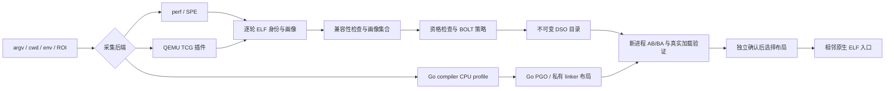

# 架构与边界

管线：`WorkloadSpec → Collector → Profile → Eligibility/Policy → Optimizer → Bundle → Validation → Selection`。
命令接口、采集、画像归一化、优化和部署分离，便于增加新的 trace 后端或优化器。

## 数据契约

- `run.json`：argv、cwd、显式 env、ROI、后端命令、进程状态。
- `profile.json`：按完整路径和 SHA256 标识的 ELF，架构、build-id、符号/重定位、
  计数权重、原始画像位置和采集范围/质量。
- `tgo.profile-set.v1`：不可变叶子 capture 的路径与 run/profile SHA256，以及逐 ELF
  的正权重 observation 引用；不借用某一轮的 perf.data/预聚合文件充当合并结果。
  嵌套集合展开，重复来源拒绝。每轮先独立处理映射，fdata 再累加；不同事件、采样
  单位或同路径 ELF 内容不能混合。负载变体需显式允许并记录差异。
- `build.json`：绑定画像与 BOLT 的 SHA，逐库命令、日志、输入/输出身份、入口、
  被跳过对象及原因。构建成功不等于有收益。
- `validation.json`：逐对正确性、真实映射、ROI/整进程时间、可用 PMU 原始值。
- `tune.json`：筛选候选与独立确认，最终可明确选择 baseline。

原始证据与中间产物保留在独立目录。目录创建拒绝复用，入口发布拒绝覆盖，失败
构建可审查，源库从不原地覆盖。CLI 可以组合到 CI 或外部调度器中；当前没有常驻
daemon，也不对已经在执行的机器码进行热补丁。在线指在线采集/attach，产物供后续启动。

## 画像正确性

QEMU 使用 per-vCPU 状态，避免把线程切换拼成分支；同线程标记决定 ROI。
未进入 marker ROI 时，通过 scoreboard 条件回调避免每块执行进入 C 回调。
连续的 QEMU TB 按真实后继 PC 合并成落空范围，非连续后继构成观察到的分支。
每个模块的地址按 loader load bias 转回 ELF VA，通过可执行 PT_LOAD 检查归属，
跨库分支采用 BOLT 的未知端点约定。统计按进程文件保存，不混合不同 ASLR 布局。
指令上限触发截断标记，默认拒绝继续；显式接受时仍保留质量字段。

`la_objopen` 的逻辑路径不总是物理路径，因此用动态表所属的 `/proc/self/maps`
映射确定真实加载文件。卸载后在同一地址重新加载不同模块会导致画像歧义，当前拒绝；
需要短 ROI 或采用带 mmap 生命周期的 perf。QEMU native exec 子进程不在本后端
范围，编译器进程树优先 perf。静态 PIE 的 QEMU 主模块 bias 尚未实现。

perf 原始文件保留 mmap/build-id 生命周期信息，由 perf2bolt 聚合。图片发现来自
loader、perf buildid-list/report，attach 可补充 `/proc/PID/maps`。ELF 身份不符拒绝。
SPE 和采样画像是统计数据，不宣称具有完整动态路径或无丢样的精度。

SPE 另有 `perf --dlfilter` 兼容桥：使用 perf 的 mmap 生命周期和 object-code API，
按真实 PC 校验 AArch64 分支指令，将已解码的源/目标转为单条 brstack。它不把采样
点挪到附近分支，统计无法读取和不支持的指令。未提供的预测位保持未知，不伪造
已预测/误预测计数；BOLT 日志也会提示缺少该位。端到端结果与转换覆盖率单独验证，
不单凭 perf 的版本号判断兼容性。公开 dlfilter API 头文件取自锁定的 Linux 6.14。

## 优化政策

有重定位时启用函数重排。默认自动策略对无重定位的 AArch64 DSO 探测 recovery
工具；不可用时使用标准策略，保留函数位置、仅在支持范围做块布局。AArch64 非
重定位输入依赖随工具构建的 ADR/ADRP 修复，不能把普通上游工具默认为等价。
loader、libc、辅助运行库被排除；Go PC/栈元数据需要独立策略。自动策略可尝试
stripped 输入中 BOLT 能识别的函数，不声称完整恢复任意剥离二进制。

基础策略使用 ext-tsp、hfsort+（有重定位）、冷热分离和 BAT；tune 比较取消分裂及
128B 对齐的候选。采集粒度、padding、指令数量与 cache 容量间存在权衡，不能仅
以静态布局好看作为收益。用户可传递 `--bolt-arg=-option=value` 作受控实验。
`--bolt-mode recover` 使用另行构建的 AArch64 recovery variant，恢复可识别的代码
引用，保留旧入口 trampoline，重排后校正 PT_LOAD 顺序。构建路径、补丁和能力检查
均独立于默认工具；没有启用假定所有代码页安全的选项。当前仅对 AArch64 DSO
验证，不把缺符号、间接分支和未解析引用默认为可移动。仍需逐负载验证实际输出。

对象重写相互独立：单库失败保留原版，成功库进入组合验证；身份变化直接失败。
整组无收益或不正确时，用同一批对象生成子集入口，先探测再完整初筛。初筛按中位数
排序，独立确认仍要求逐对获益。所有验证轮次保留各自原始证据，不覆盖先前阶段。
完整策略和预算见 [自动调优](AUTOMATIC-TUNING.md)。

Go compiler 独立使用源码 PGO 与私有 linker overlay；由 Go 正常生成运行时 metadata，
不走 BOLT 后处理。原生 toolexec 负责训练采集和只替换记录的 compiler；运行证据
使用真实 compiler 执行日志。详见 [Go compiler](GO-COMPILER.md)。

未来可加入画像驱动 ICP、更多内联策略、BAT 迭代和更多布局搜索；每项都需独立
能力检查、目标 ISA 回归、正确性和原生确认，不能直接默认打开旧实验的激进选项。

## 部署与分发

入口模板是 ELF + 长度编码配置 + footer，不执行 shell，不依赖目标 Python 包。
审计库仅提供路径搜索/加载回调，不注册符号绑定回调。DSO 的 `$ORIGIN` 展开到原
目录，同时保留 RPATH/RUNPATH 类型。ELF 主程序仍是主程序，DSO 仍是 DSO；
静态程序、musl、setuid/secure execution、Go runtime 元数据需要单独适配。

AppImage 与被优化负载的部署包是两种产物。前者可以分发；后者默认绑定原机的 ELF
与路径。AppImage 的 Python/PATH 环境只用于控制工具，不会泄漏到负载解释器。
运行所需原生 helper 已预构建，生成入口仅追加配置，所以不需要在分发机安装 CC。
入口使用带 SHA256 的 TGOCFG02 配置：stat 相同时快速通过，元数据变化时校验内容。
因此同一镜像的新容器不会仅因 overlay 设备号/inode 改变而误报 ELF 漂移。SHA256
实现随原生入口携带，不依赖外部命令或动态加密库。Go helper 同样校验内容，入口
验证后刷新当前 namespace 的 stamp，避免 compiler 每次执行都重复读取整个文件。

## 接口扩展顺序

1. 采集后端输出 `tgo.profile.v1`，声明采样/精确计数、进程树、线程与 ROI 范围。
2. 优化器声明 ELF/运行时元数据能力，输出可追溯的逐对象变换和输入身份。
3. validator 记录业务正确性、性能口径、加载证明，允许拒绝或保留原版。
4. 部署器只接受已选对象，并保留关闭优化的路径。

DynamoRIO 目前是计划的后端，没有以空壳宣称支持。一般 Go 应用程序的自动优化仍待
独立适配，不与当前 compiler workload 策略混为一谈。
